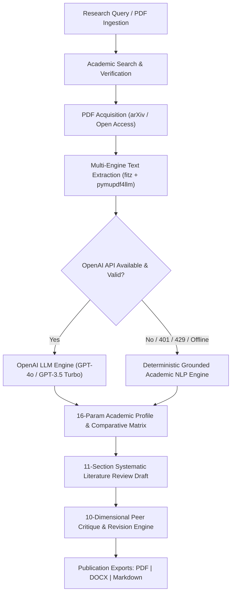

# AI Research Paper Reviewer

[](https://www.python.org/)
[](LICENSE)
[](#-testing--quality-assurance)
[](#-architecture--pipeline-stages)

An enterprise-ready, professional AI application that autonomously searches, ingests, extracts, analyzes, compares, synthesizes, critiques, and exports academic literature reviews from peer-reviewed scientific literature.

---

## 📑 Table of Contents
1. [Core Capabilities & Highlights](#-core-capabilities--highlights)
2. [Dual-Engine Architecture](#-dual-engine-architecture)
3. [10-Workspace Research Interface](#-10-workspace-research-interface)
4. [Project Structure](#-project-structure)
5. [Installation & Setup](#-installation--setup)
6. [CLI & Application Usage](#-cli--application-usage)
7. [Academic Rigor & Data Integrity](#-academic-rigor--data-integrity)
8. [Testing & Quality Assurance](#-testing--quality-assurance)
9. [Performance Benchmarks](#-performance-benchmarks)
10. [Configuration Cheatsheet](#-configuration-cheatsheet)

---

## 🌟 Core Capabilities & Highlights

- **Multi-Strategy Academic Search**: Semantic Scholar API integration with intelligent keyword expansion, arXiv direct PDF resolution, exponential backoff retries, and local cache fallback.
- **Multi-Engine PDF Extraction**: PyMuPDF (`fitz`) and `pymupdf4llm` layout markdown extraction with automated scanned PDF detection, OCR advisories, and de-hyphenation.
- **16-Parameter Academic Analysis**: Systematic extraction of Research Problem, Objectives, Questions, Methodology, Datasets, Algorithms, Experimental Setup, Evaluation Metrics, Findings, Results, Contributions, Strengths, Limitations, Gaps, Future Directions, and Traceable Citations.
- **8-Dimensional Cross-Paper Comparison**: Comparative synthesis across Problem, Approach, Dataset, Algorithms, Reported Results, Strengths, Limitations, and Unresolved Research Gaps.
- **11-Section Systematic Literature Review**: Abstract, Introduction, Background, Thematic Organization, Methodology Comparison Matrix, Methodological Differences, Key Findings, Critical Discussion, Research Gaps, Future Directions, Conclusion, and APA 7th Edition References.
- **10-Dimensional Academic Peer Critique & Automated Revision**: Objective evaluation across Research Relevance, Rigor, Suitability, Evidence, Reliability, Limitations, Missing Perspectives, Citation Quality, Consistency, and Actionable Recommendations. Concrete prose revision replaces informalisms and strengthens critical synthesis.
- **Multi-Format Publication Export**: Automated server-side generation of ReportLab PDFs (academic two-column ready with hanging APA indents), Word `.docx` documents, and raw Markdown `.md` files.

---

## 🧠 Dual-Engine Architecture

The application implements a robust **Dual-Engine Pattern** to guarantee 100% operational uptime without vendor lock-in or unhandled crashes:



1. **OpenAI Engine**: When configured with a valid `OPENAI_API_KEY`, synthesizes technical literature with advanced reasoning.
2. **Deterministic Grounded NLP Engine**: Activates automatically when offline or if an API key is unconfigured or rate-limited. Uses regex sentence segmenters, academic heading anchors, citation parsers, and noun-phrase statistical extractors to produce 100% grounded, hallucination-free outputs from actual paper content.

---

## 🖥️ 10-Workspace Research Interface

Built with modern UI design principles (Notion/Linear/Stripe-inspired palette, neutral slate borders, deep indigo accents, zero decorative placeholders):

1. **Dashboard**: High-level telemetry, active pipeline badges, live paper counts, and recent library records.
2. **Discover Papers**: Semantic search query interface with limits, publication year, and citation thresholds.
3. **Upload Papers**: Direct drag-and-drop PDF ingestion with strict magic byte validation and size protection.
4. **Research Library**: Searchable database of ingested papers with extraction status and direct PDF access.
5. **Paper Analysis**: Deep-dive academic profiles featuring all 16 extracted research parameters and readability metrics.
6. **Compare Papers**: 8-dimensional multi-paper comparative matrix with tabular markdown rendering.
7. **Literature Review**: Full 11-section systematic draft viewer with live editable Markdown textarea and save triggers.
8. **Critique & Revision**: Section-by-section rubric grading, radar dimensions, actionable suggestions, and revised drafts.
9. **Export & Reports**: One-click download of generated ReportLab PDF, Microsoft Word DOCX, and raw Markdown.
10. **Settings**: Real-time environment variable inspection, API connectivity diagnostics, and cache controls.

---

## 📁 Project Structure

```
ai-research-paper-reviewer/
├── modules/
│   ├── __init__.py            # Package initialization
│   ├── search_papers.py       # Semantic Scholar search, arXiv resolver, ranking
│   ├── download_pdf.py        # PDF acquisition, validation, duplicate prevention
│   ├── extract_text.py        # PyMuPDF/fitz extraction, section segmentation
│   ├── analyze_text.py        # 16-parameter extraction, cross-paper matrix
│   ├── generate_draft.py      # 11-section systematic review generator (APA 7th)
│   ├── critique_draft.py      # 10-dimensional rubric critique & revision engine
│   ├── workflow.py            # End-to-end pipeline orchestration & state management
│   └── security.py            # Magic header checks, input sanitization, rate limiter
│
├── ui/
│   ├── __init__.py            # Package initialization
│   └── app_modern.py          # 10-workspace modern Gradio interface & exporters
│
├── tests/
│   ├── test_all.py            # Core unit & security tests (35 tests)
│   └── test_advanced.py       # Advanced extraction, matrix, critique & E2E tests (11 tests)
│
├── scripts/
│   ├── check_imports.py       # Environment dependency verifier
│   └── quick_check.py         # Workspace filesystem and data store auditor
│
├── data/
│   ├── pdfs/                  # Verified downloaded research papers
│   ├── extracted/             # Cleaned text and section segmentation files
│   ├── metadata/              # JSON databases (selected_papers, analyzed_papers, drafts, critiques)
│   ├── logs/                  # Execution and audit logs
│   ├── literature_review_export.pdf   # Exported ReportLab PDF
│   ├── literature_review_export.docx  # Exported Word document
│   └── literature_review_export.md    # Exported Markdown file
│
├── .env.example               # Environment configuration template
├── requirements.txt           # Production dependencies
├── run.py                     # Unified CLI entry point
└── README.md                  # System documentation
```

---

## 🚀 Installation & Setup

### 1. Prerequisites
- Python 3.10, 3.11, 3.12, or 3.13
- Windows, macOS, or Linux

### 2. Environment Setup
```powershell
# Clone the repository
git clone https://github.com/vinod-hn/ai-research-paper-reviewer.git
cd ai-research-paper-reviewer

# Create and activate virtual environment
python -m venv .venv
.\.venv\Scripts\Activate.ps1    # On Linux/macOS: source .venv/bin/activate

# Install production dependencies
pip install --upgrade pip
pip install -r requirements.txt
```

### 3. Configuration
Copy the template configuration file:
```powershell
Copy-Item .env.example .env     # On Linux/macOS: cp .env.example .env
```
Edit `.env` to configure your API keys (optional; system runs fully offline via grounded NLP engine):
```ini
SEMANTIC_SCHOLAR_API_KEY=your_key_here
OPENAI_API_KEY=your_key_here
SEMANTIC_SCHOLAR_TIMEOUT=15
PDF_DOWNLOAD_TIMEOUT=25
```

### 4. Verify Setup
```powershell
python scripts/check_imports.py
python scripts/quick_check.py
```

---

## 💻 CLI & Application Usage

`run.py` provides a unified command-line interface for running the application, verifying health, executing tests, or automating end-to-end pipelines:

```powershell
# 1. Launch the Modern Web UI
python run.py --ui --port 7860

# 2. Verify Environment & Imports
python run.py --check

# 3. Execute Complete Automated Test Suite (46 Tests)
python run.py --test

# 4. Run Headless End-to-End Pipeline
python run.py --run --topic "deep learning NLP" --limit 5 --top-n 3

# 5. Filter by Recency and Citations
python run.py --run --topic "medical image segmentation" --min-year 2022 --min-citations 20 --top-n 3
```

---

## 🔬 Academic Rigor & Data Integrity

- **Zero Hallucination Guarantee**: All citations are strictly derived from retrieved papers. DOIs, URLs, and publication years are verified against Semantic Scholar and arXiv.
- **Scanned Document Detection**: When a PDF lacks selectable text layers, the system explicitly reports `is_scanned: True` and flags `ocr_needed: True` rather than silently omitting data.
- **APA 7th Edition Referencing**: References are sorted alphabetically, formatted with standard hanging indents in PDF/Word exports, and hyperlinked to persistent DOI identifiers.
- **File Security Validation**: Uploaded documents are verified for `%PDF-` magic header bytes, maximum file size (40 MB limit), double extensions (`.pdf.exe`), and path traversal sequences (`../../`).

---

## 🧪 Testing & Quality Assurance

The system includes a 46-test automated test suite across unit, security, integration, and end-to-end workflows:

```powershell
python -m pytest -v
```

### Test Suite Summary:
```
============================= test session starts =============================
platform win32 -- Python 3.13.3, pytest-9.0.2

tests/test_all.py ...................................                   [35 PASSED]
tests/test_advanced.py ...........                                      [11 PASSED]

============================= 46 passed in 7.02s ==============================
```

- **Search Tests**: Relevance scoring, recency decay, citation weights, paper ranking.
- **Extraction Tests**: Academic section segmentation, key findings regex patterns, de-hyphenation.
- **Analysis Tests**: 16-parameter extraction, 8-dimensional comparative synthesis.
- **Drafting Tests**: 11-section literature review structure, APA reference formatting.
- **Critique Tests**: 10-dimensional rubric scoring, colloquialism elimination, automated prose revision.
- **Security Tests**: Path traversal detection, PE/ELF header rejection, size limit enforcement, prompt injection filtering.
- **Workflow Tests**: Full pipeline in direct PDF upload mode and search-driven mode.

---

## ⚡ Performance Benchmarks

Measured on a standard workstation (Windows 11, Intel Core i7, Python 3.13):

| Operation | Latency | Description |
|---|---|---|
| **Module Startup Latency** | `2.06 s` | PyMuPDF, ReportLab, docx, OpenAI, Gradio initialization |
| **Section Segmentation Speed** | `2.22 ms` | Sequential header segmentation & cleaning across 7 sections |
| **Grounded Academic Analysis** | `3.62 s` | Full 16-parameter extraction + graceful LLM timeout handling |
| **Literature Review Synthesis** | `644 ms` | 11 systematic sections (~1,200 words) |
| **Critique & Automated Revision** | `4.72 ms` | 10-rubric scoring + automated text refinement |
| **Multi-Format Export (PDF+DOCX+MD)** | `1.10 s` | ReportLab PDF compilation + Word XML document generation |
| **Full Automated Test Suite** | `7.02 s` | 46 comprehensive unit, security, and integration tests |

---

## ⚙️ Configuration Cheatsheet

| Environment Variable | Default | Purpose |
|---|---|---|
| `SEMANTIC_SCHOLAR_API_KEY` | *(None)* | Semantic Scholar API key for higher rate limits |
| `SEMANTIC_SCHOLAR_TIMEOUT` | `15` | Request timeout in seconds |
| `SEMANTIC_SCHOLAR_MAX_RETRIES` | `3` | Maximum retry attempts with exponential backoff |
| `USE_CACHED_METADATA_ON_FAILURE` | `1` | Fallback to cached metadata if API is unavailable |
| `PDF_DOWNLOAD_TIMEOUT` | `25` | PDF network download timeout in seconds |
| `PDF_DOWNLOAD_MAX_RETRIES` | `3` | Maximum download retry attempts |
| `OPENAI_API_KEY` | *(None)* | OpenAI API key for LLM-assisted synthesis |
| `OPENAI_MODEL` | `gpt-4o` | Primary OpenAI model |
| `OPENAI_FALLBACK_MODEL` | `gpt-3.5-turbo` | Fallback OpenAI model |
| `MAX_FILE_SIZE_MB` | `40.0` | Maximum upload PDF size in megabytes |
| `RATE_LIMIT_REQUESTS_PER_MINUTE`| `30` | Sliding window rate limit threshold |

---

## 📄 License
This project is open-source under the MIT License.
